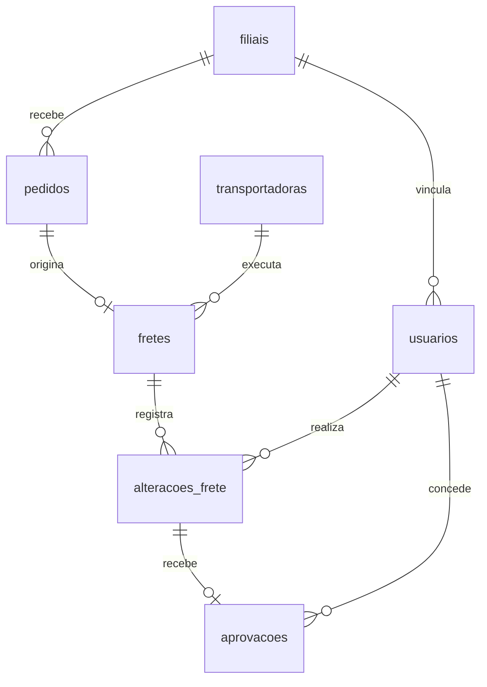

# Auditoria de alterações de frete

**Status em construção** · Projeto de portfólio com dados fictícios gerados em SQLite.

## Objetivo e escopo

Testar se aumentos no valor de fretes pagos receberam aprovação independente antes do pagamento. O risco é pagar um valor alterado sem revisão. A base simula o fluxo de pedidos, contratação, ajustes, aprovação e pagamento de um ERP de logística.

Cada pedido tem um frete. Um frete pode ter zero, uma ou duas alterações, e cada alteração pode ter até uma aprovação registrada. O teste inicial considera apenas fretes pagos. Fretes abertos e cancelados ajudam a testar o recorte.

## Regra simulada

A [Norma Interna NOR-LOG-001](norma-interna-fretes.md) define o critério de aprovação e as evidências usadas no teste.

Cada aumento **superior a R$ 500,00**, calculado em relação ao valor imediatamente anterior, exige aprovação por outra pessoa, após a alteração e antes do pagamento. A regra é aplicada por alteração. Reduções e aumentos de até R$ 500,00 ficam fora do critério.

Os valores são armazenados em centavos e os horários em UTC no formato ISO 8601. A geração é determinística. Recriar a base produz os mesmos registros e as mesmas exceções.

## Como carregar no DBeaver

1. Crie uma conexão SQLite apontando para um arquivo vazio chamado `auditoria_erp.db`. Escolha um arquivo diferente do banco de cinco fretes.
2. Abra um editor SQL nessa conexão, cole o conteúdo de [base.sql](base.sql) e execute o script completo com **Alt+X**.
3. Atualize a lista de tabelas e rode a consulta abaixo com **Ctrl+Enter**. Execute o script de carga uma vez por banco novo.

```sql
SELECT
    (SELECT COUNT(*) FROM fretes) AS total_fretes,
    (SELECT COUNT(*) FROM alteracoes_frete) AS total_alteracoes,
    (SELECT COUNT(*) FROM aprovacoes) AS total_aprovacoes;
```

Pelo terminal, com o cliente SQLite instalado e aberto na pasta do projeto, use `sqlite3 -bail auditoria_erp.db ".read base.sql"`. Para publicar no GitHub, inclua o script que recria a base.

## Modelo e volume esperado

| Tabela | Registros | Conteúdo |
| --- | ---: | --- |
| `filiais` | 6 | Nome e UF |
| `transportadoras` | 24 | Nome fictício e modal |
| `usuarios` | 60 | Filial e perfil de operação ou supervisão |
| `pedidos` | 12.000 | Filial, canal, data e peso |
| `fretes` | 12.000 | Pedido, transportadora, rota, valor contratado, status e data de pagamento |
| `alteracoes_frete` | 10.000 | Autor, valor anterior e novo, data e motivo |
| `aprovacoes` | 5.669 | Alteração, aprovador e data |

### Modelo relacional



A chave primária (`PRIMARY KEY`) identifica cada linha. A chave estrangeira (`REFERENCES`) aponta para outra tabela. A restrição `UNIQUE` limita a repetição de um valor ou de uma combinação de valores.

| Chave | Papel no modelo |
| --- | --- |
| `fretes.pedido_id` → `pedidos.id` | Chave estrangeira com `UNIQUE`. Cada frete pertence a um pedido, e cada pedido pode ter até um frete. |
| `alteracoes_frete.frete_id` → `fretes.id` | Chave estrangeira que pode se repetir. Um frete pode ter várias alterações, então o teste conta alterações. |
| `aprovacoes.alteracao_id` → `alteracoes_frete.id` | Chave primária e estrangeira. Cada alteração pode ter até uma aprovação. |
| `alteracoes_frete.alterado_por` e `aprovacoes.aprovado_por` → `usuarios.id` | Identificam quem alterou e quem aprovou. A comparação entre os dois campos permite detectar autoaprovação. |

O diagrama representa as restrições do esquema. A carga fictícia gera um frete por pedido e até duas alterações por frete. O esquema também permite pedidos sem frete e mais de duas alterações por frete.

### Conferir o esquema com acesso somente leitura

No DBeaver, com acesso de leitura ao SQLite, consulte os metadados para ver as definições das tabelas sem percorrer os registros.

```sql
SELECT name AS tabela, sql AS definicao
FROM sqlite_schema
WHERE type = 'table'
  AND name NOT GLOB 'sqlite_*'
ORDER BY name;
```

A coluna `definicao` contém o `CREATE TABLE`. Se a grade truncar o texto, selecione a célula e abra o painel **Value** para ver a definição completa, incluindo `PRIMARY KEY` e `UNIQUE`.

Para conferir apenas as chaves estrangeiras, execute uma instrução por vez.

```sql
PRAGMA foreign_key_list('alteracoes_frete');
PRAGMA foreign_key_list('aprovacoes');
```

Na saída, `from` é a coluna de origem e `table` e `to` identificam a tabela e a coluna de destino. Se o acesso estiver limitado a telas, relatórios ou views que ocultam as restrições, marque as relações como inferidas e confirme-as com o dicionário de dados.

## Testes de auditoria e reconciliação

### 1. Conferir a população

Conte as alterações acima de R$ 500,00 em fretes pagos antes de consultar as aprovações. O resultado esperado é **5.456 alterações**.

```sql
SELECT COUNT(*) AS total_no_escopo
FROM alteracoes_frete AS a
JOIN fretes AS f ON f.id = a.frete_id
WHERE f.status = 'PAGO'
  AND a.valor_novo_centavos - a.valor_anterior_centavos > 50000;
```

### 2. Classificar as alterações

O `LEFT JOIN` preserva alterações sem aprovação. O `CASE` usa a primeira condição atendida, na ordem de ausência de aprovação, autoaprovação e aprovação fora da ordem exigida. Assim, cada alteração entra em apenas uma categoria.

```sql
WITH classificadas AS (
    SELECT
        a.id AS alteracao_id,
        f.id AS frete_id,
        a.valor_novo_centavos - a.valor_anterior_centavos AS aumento_centavos,
        a.alterado_por,
        ap.aprovado_por,
        a.alterado_em,
        ap.aprovado_em,
        f.pago_em,
        CASE
            WHEN ap.alteracao_id IS NULL
                THEN 'Sem aprovação registrada'
            WHEN ap.aprovado_por = a.alterado_por
                THEN 'Autoaprovação'
            WHEN ap.aprovado_em <= a.alterado_em
              OR ap.aprovado_em >= f.pago_em
                THEN 'Aprovação fora da ordem exigida'
            ELSE 'Conforme'
        END AS classificacao
    FROM alteracoes_frete AS a
    JOIN fretes AS f ON f.id = a.frete_id
    LEFT JOIN aprovacoes AS ap ON ap.alteracao_id = a.id
    WHERE f.status = 'PAGO'
      AND a.valor_novo_centavos - a.valor_anterior_centavos > 50000
)
SELECT *
FROM classificadas
ORDER BY alteracao_id;
```

### 3. Reconciliar as contagens

Mantenha o bloco `WITH classificadas AS (...)` e substitua o `SELECT` final pelo trecho abaixo. No DBeaver, execute o bloco completo como uma única instrução.

```sql
SELECT
    classificacao,
    COUNT(*) AS total_alteracoes
FROM classificadas
GROUP BY classificacao
ORDER BY classificacao;
```

Use estes totais para conferir sua consulta. A unidade de análise é **a alteração**, mesmo quando um frete aparece mais de uma vez.

| Classificação entre alterações acima do limite em fretes pagos | Total |
| --- | ---: |
| Sem aprovação registrada | 420 |
| Autoaprovação | 298 |
| Aprovação fora da ordem exigida | 249 |
| Conforme | 4.489 |
| **Total no escopo** | **5.456** |

**Validação em SQLite:** a consulta detalhada retornou 5.456 IDs de alteração distintos. As três categorias de exceção somaram 967 registros. Com os 4.489 conformes, o total reconciliado foi de 5.456, com diferença zero em relação à contagem independente.

As quatro categorias devem somar o mesmo total da contagem independente. Os 249 casos fora da ordem, nesta base, correspondem a aprovações posteriores ao pagamento. A consulta também sinaliza aprovações anteriores à alteração ou registradas no mesmo horário da alteração ou do pagamento.

A base inclui aumentos de R$ 499,99, R$ 500,00 e R$ 500,01 para testar a fronteira da regra. Se a contagem divergir, confira se a junção com aprovações usa `LEFT JOIN` e se o limite é `> 50000`. Aprovação ausente é um sinal para investigação. Em uma auditoria real, verifique a completude da extração e os registros do ERP antes de concluir que houve falha.

## Taxa de exceções por filial

Cada alteração é atribuída à **filial do pedido**. O numerador conta as alterações classificadas como exceção. O denominador inclui todas as alterações no escopo da mesma filial, conformes ou com exceção.

No bloco `WITH classificadas AS (...)` da seção anterior, acrescente `p.filial_id` ao `SELECT` e inclua `JOIN pedidos AS p ON p.id = f.pedido_id` logo após a junção com `fretes`. Substitua o `SELECT` final pelo trecho abaixo e execute a instrução completa no DBeaver.

```sql
SELECT
    fi.nome AS filial,
    COUNT(*) AS total_no_escopo,
    SUM(CASE WHEN c.classificacao <> 'Conforme' THEN 1 ELSE 0 END)
        AS total_excecoes,
    ROUND(
        100.0 * SUM(CASE WHEN c.classificacao <> 'Conforme' THEN 1 ELSE 0 END)
        / COUNT(*),
        2
    ) AS taxa_excecoes_pct
FROM classificadas AS c
JOIN filiais AS fi ON fi.id = c.filial_id
GROUP BY fi.id, fi.nome
ORDER BY taxa_excecoes_pct DESC, fi.id;
```

### Resultados e achados da simulação

| Filial | Alterações no escopo | Exceções | Taxa de exceções |
| --- | ---: | ---: | ---: |
| **Belo Horizonte** | **861** | **227** | **26,36%** |
| Vitória | 861 | 187 | 21,72% |
| Campinas | 862 | 177 | 20,53% |
| Curitiba | 939 | 125 | 13,31% |
| São Paulo | 992 | 130 | 13,10% |
| Rio de Janeiro | 941 | 121 | 12,86% |
| **Total geral** | **5.456** | **967** | **17,72%** |

- **Belo Horizonte liderou em taxa e em volume de exceções.** Com o mesmo número de alterações no escopo que Vitória, registrou 40 exceções a mais. É o ponto de partida para detalhar os tipos de exceção e selecionar casos para investigação.
- **Taxa e volume respondem a perguntas diferentes.** São Paulo teve mais exceções que Curitiba (130 contra 125), mas uma taxa menor (13,10% contra 13,31%) porque teve mais alterações no escopo.
- **Os totais por filial foram reconciliados.** A soma das seis filiais bateu com a análise geral em população e exceções. A taxa geral usa `967 ÷ 5.456 × 100`, ponderando cada filial pelo seu volume de alterações.

## Investigação de dois casos em Belo Horizonte

Foram selecionadas duas alterações da filial com a maior taxa de exceções na simulação, uma sem aprovação registrada e outra com aprovação posterior ao pagamento. O critério é a [NOR-LOG-001](norma-interna-fretes.md). Cada aumento acima de R$ 500,00 exige aprovação por outra pessoa após a alteração e antes do pagamento.

No DBeaver, mantenha o bloco `WITH classificadas AS (...)` da seção **Classificar as alterações** e substitua o `SELECT` final pelo trecho abaixo. Execute o bloco completo como uma instrução.

```sql
SELECT
    alteracao_id,
    frete_id,
    aumento_centavos / 100.0 AS aumento_reais,
    alterado_por,
    aprovado_por,
    alterado_em,
    aprovado_em,
    pago_em,
    classificacao
FROM classificadas
WHERE alteracao_id IN (1742, 1862)
ORDER BY alteracao_id;
```

| Evidência na base fictícia | Alteração 1742 | Alteração 1862 |
| --- | --- | --- |
| Frete | 174 | 186 |
| Aumento | R$ 703,94 | R$ 707,66 |
| Alteração | 07/03/2026 às 10h UTC, usuário 38 | 30/03/2026 às 10h UTC, usuário 31 |
| Pagamento | 11/03/2026 às 8h UTC | 03/04/2026 às 8h UTC |
| Aprovação | Sem registro vinculado | 04/04/2026 às 8h UTC, usuário 39 |
| Classificação | Sem aprovação registrada | Aprovação fora da ordem exigida |

### Alteração 1742 — ausência de aprovação na extração

**Evidência adicional a solicitar.** Histórico completo de aprovações da alteração 1742 no ERP, com o identificador do aprovador e o horário do evento. Se houver aprovação no ERP, solicitar também o registro e os filtros da extração para investigar a divergência.

**Conclusão preliminar.** O frete foi pago e a extração não contém evidência da aprovação exigida. A trilha completa do ERP permitiria verificar se a aprovação ocorreu antes do pagamento ou confirmar a ausência do registro na origem.

### Alteração 1862 — aprovação posterior ao pagamento

**Evidência adicional a solicitar.** Trilha de aprovação no ERP e comprovante de execução do pagamento, ambos com os horários efetivos. Se a sequência for confirmada, solicitar o registro de liberação do pagamento para identificar como ele avançou antes da aprovação.

**Conclusão preliminar.** O aprovador é diferente do autor da alteração, mas a aprovação foi registrada 24 horas após o pagamento. A sequência observada contraria o prazo da norma. A confirmação depende dos registros de origem.

As conclusões se limitam aos registros da base fictícia. As solicitações de evidência fazem parte da simulação.

## Próximas entregas

- [x] Definir o escopo, a regra e os cenários.
- [x] Gerar a base fictícia em SQLite.
- [x] Desenhar o modelo relacional e documentar as principais chaves.
- [x] Escrever consultas para identificar as exceções e reconciliar os totais.
- [x] Comparar a taxa de exceções por filial usando como denominador as alterações no escopo de cada filial.
- [x] Investigar dois casos e registrar a evidência adicional que seria solicitada.
- [ ] Publicar um resumo de auditoria e, se houver, uma captura do painel.
